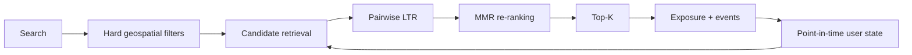
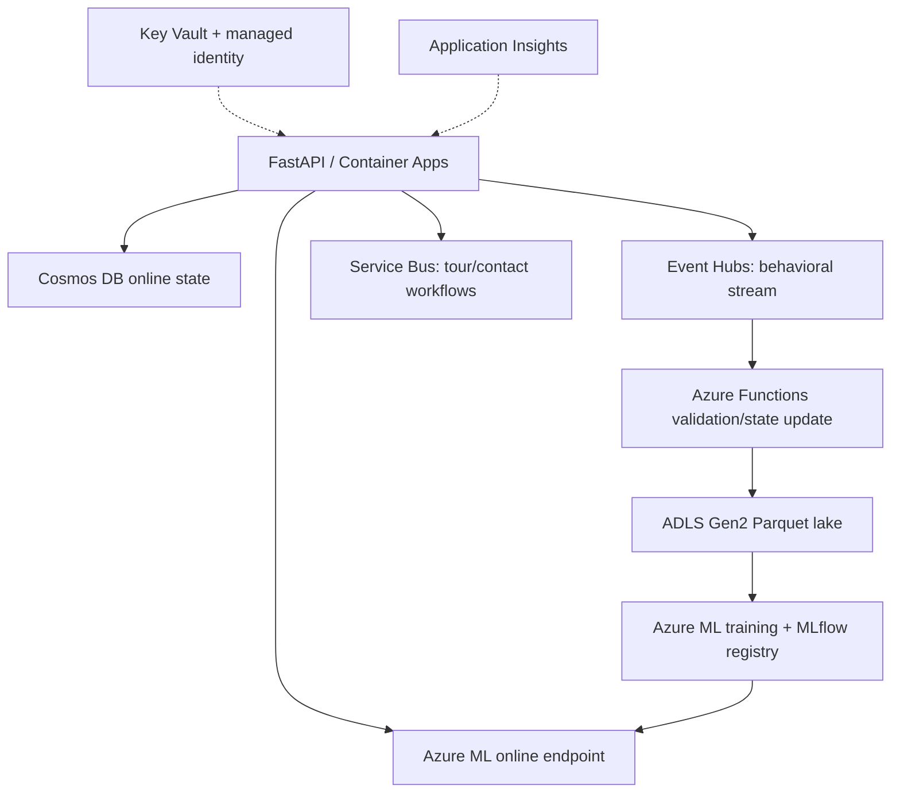

# Personalized Real-Estate Search & Ranking Platform

A marketplace may contain millions of homes. This local-first ML product combines explicit search constraints, public property records, learned preferences, behavioral history, candidate retrieval, pairwise learning-to-rank, and diversity re-ranking to decide which eligible properties each user sees first.



The demonstration market is **Montgomery County, Maryland**. Physical records in real mode come from the official Maryland Real Property Assessments open-data export; current marketplace listing state and every user interaction are explicitly simulated. No commercial listing site is scraped.

## Product architecture

Popularity, content/preference, and standardized-vector retrieval independently narrow the eligible catalog. The query-group-aware pairwise ranker uses inverse exposure propensity weights; MMR then trades a small amount of score for type/price diversity. Price, radius, bedroom, bathroom, type, status constraints are never relaxed. New users fall back to explicit query intent and popularity; new listings are retrievable from content immediately.



Event Hubs is for high-volume immutable behavior; Service Bus is for durable business workflows. ADLS is offline analytical storage, while Cosmos DB serves low-latency state. Local JSONL, in-memory queues, files, and the in-process ranker implement the same interfaces without Azure credentials.

## Real vs simulated

| Data | Provenance | Use |
|---|---|---|
| assessment attributes and coordinates (real mode) | `PUBLIC_SOURCE` | physical inventory |
| distance, freshness, compatibility | `DERIVED_PUBLIC` / `MODEL_GENERATED` | retrieval/ranking |
| asking price, status, days on market | `SIMULATED` | marketplace layer |
| users, searches, impressions, funnel actions | `SIMULATED` | private behavior substitute |

Assessment value is never described as listing price. The simulation derives a fictional asking price and labels it accordingly. Protected characteristics and demographic proxies are excluded; see [housing fairness](docs/responsible_ml/housing_fairness.md).

## Local quick start

```bash
make setup
make data MODE=sample
make train
make evaluate
make demo
make serve
```

Open `http://localhost:8000/docs`. CI uses offline synthetic/sample data. `make data MODE=real` intentionally stops with safe instructions: provide the current official export URL to `scripts/download_public_data.py`, then map the downloaded schema rather than scraping SDAT. This prevents unnoticed upstream schema or terms changes.

## Evaluation, monitoring, and experimentation

Temporal splits are chronological and historical features must precede prediction time. Retrieval is evaluated with Recall@K and coverage; ranking with NDCG@10/20, MRR, MAP, precision and recall. The included `evaluate.py` output is clearly marked a smoke fixture—not a claimed model result. Run-generated values live in ignored `reports/`; no metric is fabricated in this README.

Stable hashing assigns experiments. Exposure propensity is logged for inverse-propensity correction. Analysis utilities include confidence intervals and sample-ratio mismatch detection. Production monitoring covers p50/p95 latency, errors, candidate recall/coverage, NDCG after label arrival, diversity, catalog concentration, funnel rates, drift, missingness, and inventory freshness. Higher offline NDCG is a gate, not proof of online business lift.

## Responsible ML, security, cost, and scale

Housing ranking can amplify geographic and popularity bias. Only explicit user geography and property/product attributes are used. Audit exposure and outcome quality by lawful, reviewed cohorts outside the ranker; never infer protected traits. Feedback loops require exploration traffic, propensity logging, catalog coverage limits, and periodic counterfactual evaluation.

Production uses managed identity, least-privilege RBAC, Key Vault, private endpoints, request validation, rate limiting, and PII-safe structured logs. No credentials belong in source. Azure services incur usage costs; start with low-throughput tiers, budgets, autoscale-to-minimum, and destroy development resources after evaluation. At millions of properties, replace exact local vector scoring with partitioned HNSW/FAISS, cache hard-filter sets, stream state updates, and use distributed point-in-time feature jobs. This laptop implementation does not claim internet scale.

## Repository map

`src/real_estate_ranking` separates data, simulation, geospatial search, retrieval, features/ranking, re-ranking, experimentation, events, and serving. `infrastructure/terraform` defines cloud resources; `docs/` contains provenance, fairness, ADRs, deployment, and limitations. Tests include constraints, temporal leakage, metrics, idempotency, deterministic assignment, API contracts, and the full search path.

